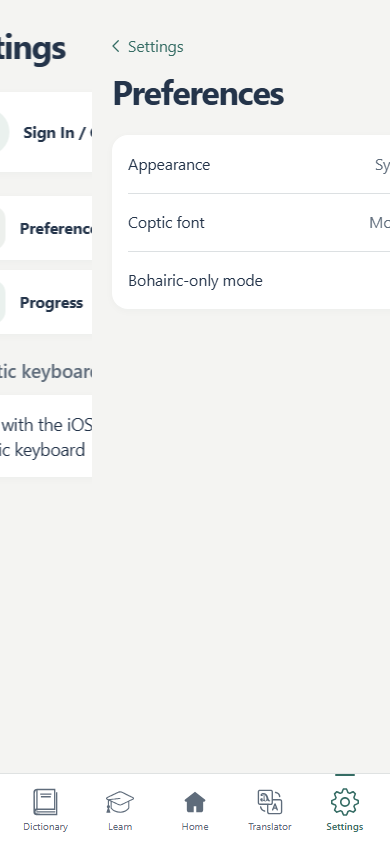
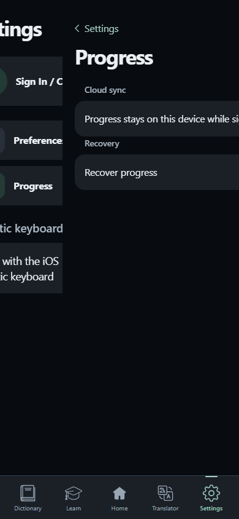
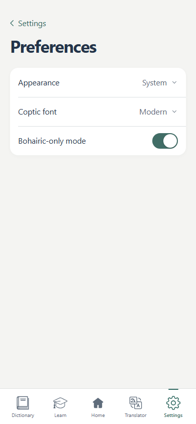

# Phase 2C navigation architecture (before implementation)

Base: main, `2338a0ba40a782456ccb125cb463fe6789b51d88` (PR #12).

The existing AppLink and Settings buttons call App Router push/back/replace.
NavigationScrollReset owns a small history hint and document scroll reset.
There is no Settings layout. The root layout owns authentication, automatic
sync, native experience, viewport safe areas, and the fixed bottom dock.
WKWebView supplies document momentum and vertical bounce; only lesson exercise
routes lock its scroll view. These responsibilities must remain unchanged.

## Decision

Add one persistent `app/settings/layout.tsx` host. Extract the Settings root
content from its route entry and give Subpage an explicit section prop. Route
entries remain statically exported public URLs; the layout owns their actual
React surfaces. Never retain App Router `children` as old-page snapshots: those
children contain live router contexts and are not independent old pages.

The host retains an explicit current page and, only while transitioning, one
other page. React keys identify each real surface. At rest there is exactly one
mounted page. Non-active layers are inert and aria-hidden. Cancellation keeps
the current component (including form drafts); completion unmounts the outgoing
component. Application providers never enter this stack. No DOM cloning,
body append, global mutation observation, or duplicate application trees.

Keep App Router push/back/replace and public deep links. A scoped navigation
delegate captures scroll and direction before routing, rejects repeated taps
while pending, and waits for usePathname to confirm the route. Browser traversal
uses entry identities and indices, not a guess based on page depth. Refresh and
direct entries have a semantic parent but do not claim an unknown browser entry;
Back replaces the route in that case. Unmount unregisters the delegate.

Whole surfaces use transform-only Web Animations (300 ms). The incoming layer
is positioned relative to the host, with document-scroll compensation. The
host is opaque, horizontally clipped, and remains in normal document flow.
There is no new vertical scroller, fixed page overlay, or body scroll lock.
Animation completion/cancellation owns cleanup; resize, background, navigation
interruption and unmount cancel animations deterministically. Reduced Motion,
missing animation/inert support, a session kill switch, or animation failure
select direct unanimated routing.

Use a host-scoped touch recognizer, plus mouse pointer tracking for desktop
testing. A one-finger start in the left 24 CSS pixels becomes navigation only
after a rightward horizontal threshold; vertical/ambiguous gestures stay native.
Inputs, selection, sliders and marked horizontal scrollers are excluded. Only
accepted horizontal moves prevent default. The same two real layers follow
finger progress; release completes or cancels. History is touched once on
commit and never on cancel. A direct submenu has its semantic parent available.

UIKit edge-pan bridging was considered. A custom bridge adds gesture arbitration
with WKWebView and lifecycle messaging; WKWebView's built-in history gestures
do not expose the React surface progress/cancellation contract. Prefer the web
implementation pending physical iPhone acceptance; do not enable a competing
native recognizer. Safari's system edge gesture may take precedence outside the
Capacitor app and must safely cancel the web gesture.

References: [Next layouts](https://nextjs.org/docs/app/getting-started/layouts-and-pages),
[Next navigation](https://nextjs.org/docs/app/getting-started/linking-and-navigating),
[WKWebView gestures](https://developer.apple.com/documentation/webkit/wkwebview/allowsbackforwardnavigationgestures).

## Stages and validation

A: explicit host, direct routing, rendered browser checks before animation.
B: button/history push/pop and lifecycle interruption checks before gestures.
C: finger tracking, cancel/commit, scroll, forms, tab switching, frame capture.
Run full Node, TypeScript, lint, export, mobile/auth/progress regression suites
and Capacitor sync. macOS CI supplies simulator startup and unsigned device IPA.
Browser automation and simulator startup do not verify physical iPhone motion.

## Recorded local validation

- Stage A: TypeScript, Settings unit tests and existing rendered mobile Settings
  smoke passed before enabling animations (commit `fd85278`).
- Stage B: rendered intermediate push frames, persistent host/dock identity,
  history, scroll restoration, repeated taps, deep links, recovery, tab changes,
  Reduced Motion and fallback passed before adding gestures (`64b9383`).
- Stage C: 177 Node tests pass, including auth/progress/cloud-sync regressions;
  TypeScript passes; ESLint reports zero errors and eight pre-existing warnings.
- Production Next export completed (1,294 static pages); Capacitor sync copied
  assets and updated plugins successfully. Windows-generated pnpm/Swift paths
  were discarded, retaining the repository's portable native project paths.
- Production navigation suite passed in Chromium (CDP touch injection) and
  WebKit (real mouse pointer drags; Playwright WebKit has no touch-drag API).
  Actual account form values/mode survived cancellation; no form was submitted.
- Tests assert intermediate push/pop and drag transforms, cancelled and committed
  history, deep links, rapid input, delayed routes, runtime animation failure,
  light/dark opaque layers, scroll restoration, interrupted transitions and
  removal of inactive pages. They wait for initial React server-stream hydration
  to drain before asserting the single host; no document reload may substitute
  for a push (host and dock node identity are checked).
- The static smoke servers serve Next's `.txt` route payloads as `text/plain`.
  An incorrect MIME type silently forces document reloads and cannot validate
  persistent navigation. Both development and production exports were exercised.

Screenshots below are browser frames, not physical-device evidence. CI uploads
full browser recordings and frames as `settings-navigation-video-and-frames`.
The existing macOS validation job uploads `CoptLingo-unsigned-iphone-ipa` after
simulator startup and unsigned device compilation. See the PR for final run links.

## Implementation and fallback

The host mounts at most two unique route surfaces. It uses 300 ms transform
animations with 25% parallax underneath. A scoped, non-passive touchmove listener
prevents scrolling only after a rightward drag exceeds 10 px and is more than
1.5 times the vertical displacement. Starts must be within 24 px of the host's
left edge. Commit requires 35% of the page width, or at least 40 px with recent
forward velocity of 0.5 px/ms. A paused release cannot use stale velocity.
The same surfaces remain mounted during tracking, settling and route loading.

History entries carry a Settings session, monotonic index, bounded ancestor
trail, and document scroll offset while preserving Next's own history state.
Scroll events retain precise offsets in memory. History persistence waits for
scrolling to rest and is throttled, avoiding WebKit's history-write rate limit;
explicit navigation and page hide also persist the current offset.
Buttons and gesture commits call App Router once; gesture cancellation calls
neither push, replace nor back. Browser navigation that interrupts a transition
settles the actual URL and cannot resurrect its abandoned destination.
Account drafts survive cancelled drags because the original keyed surface
remains mounted. Completed departures unmount form state as before.
Progress previews do not schedule cloud synchronization; the global sync
provider and all synchronization algorithms are unchanged.

Disable motion for the current browser session with
`sessionStorage.setItem('coptic-settings-motion', 'off')`; remove the key to
restore it. This is a diagnostic switch, not a new Settings control. Reduced
Motion, unsupported animation/inert APIs, or compositor failure also select
direct routing. Reduced Motion disables the custom gesture; the Back link
remains available. Slow routes retain the source until App Router commits;
an 8-second route watchdog releases the lock and disables subsequent motion.
No DOM snapshots, page cloning, body overlays or mutation observers are used.

## Physical iPhone feedback and focused visual polish

The user tested the first Phase 2C IPA on a physical iPhone and reported very
good push/pop and interactive swipe tracking, cancellation and responsiveness.
The remaining reports were an initial “Opening…” skeleton and brief clipped or
partial transition frames. The interaction design, timing, thresholds, history
and persistent React stack are retained.

Two defects were reproduced against the previous production export in WebKit:

1. Holding the cold Settings layout JavaScript request exposed the root
   `app/loading.tsx` fallback. The exported Settings HTML also placed its real
   host inside a hidden React streaming segment behind that fallback. The root
   boundary intercepted the entire Settings layout, before its own readiness
   handling could run. Loading boundaries now belong to the other top-level
   routes, which keep their existing fallback. Settings entry retains the real
   previous screen until ready, and its static document contains visible page
   content before hydration. No loading state is falsely marked complete.
2. `show()` cancelled filled Web Animations before React committed the settled
   surface. The still-mounted source/destination immediately reverted to their
   starting inline transforms. A regression probe recorded both `from` and `to`
   surfaces being cancelled prematurely. Cleanup now occurs in the existing
   layout-effect commit lifecycle, retaining the endpoint until the real page
   handoff. Scene replacement follows the same rule. No compositor CSS guesses,
   card spacing changes or new overlays were needed.

New regression coverage holds cold layout loading, checks exported pages with
JavaScript disabled, verifies the completion handoff, and records repeated
push/pop frames at 0, 30, 75, 150, 225 and 299 ms plus settled frames. It checks
heading geometry and ancestor clipping, fixed dock position and unique surfaces.
The existing scroll, light/dark, history, gesture cancel/commit and form-state
checks remain. These checks identify specific lifecycle defects; without the
original recording, they cannot attribute every reported physical paint artifact.
The refreshed IPA still requires physical acceptance for visual continuity.

## Final heading-focus and Settings-tab corrections

Further physical testing confirmed excellent motion and layout. Two narrowly
scoped corrections preserve that implementation:

- WebKit reproduced an `auto` outline on the programmatically focused title.
  Only Settings `h1[tabindex="-1"]:focus` loses its outline; the actual focused
  heading, screen-reader target and interactive keyboard focus rings remain.
  The focus query explicitly selects the settled current surface.
- AppLink classifies a return from a Settings child to `/settings` as Back.
  The existing host traverses to the closest recorded matching ancestor (one
  browser traversal, including nested returns); without a known ancestor it
  replaces the direct entry. The selected root tab does nothing. Entries from
  other tabs still use their existing forward routing.

Browser regressions check heading focus and interactive focus rings in both
themes, bottom-tab pop frames from Preferences/Progress/Account, a nested
Recovery-to-root traversal and Forward history, direct-entry replacement,
rapid taps and the stationary dock. Existing swipe tests are unchanged apart
from also checking the committed destination's heading focus.

## Physical iPhone follow-up acceptance

Install the unsigned IPA using the existing signing/sideloading workflow. Test
on a physical iPhone in light/dark mode and with iOS Reduce Motion both ways.

- [ ] Open Settings → Account, Preferences, Progress → Recovery. Verify smooth
      right-side entry, correct leftward parallax, and no content flashing.
- [ ] Use Back at each depth; verify reversed motion and a stationary tab bar.
- [ ] Drag from the left edge slowly and hold at 25%, 50% and 75%. Verify the
      page follows the finger continuously with no stretching or stray content.
- [ ] Release short/slow, reverse direction, and trigger touch cancellation.
      Verify smooth return, unchanged URL/history and preserved account drafts.
- [ ] Complete a long swipe and a short fast swipe. Verify exactly one back
      traversal; the Settings root must never activate this gesture.
- [ ] Scroll vertically, including left-edge drags, momentum and rubber-band
      overscroll. Verify native bounce and matching light/dark canvas colors.
- [ ] Test inputs, text selection, selectors and switches; no accidental Back.
- [ ] Test large text, VoiceOver, safe areas, landscape and keyboard appearance.
- [ ] Refresh/reopen each deep link. Back/Swipe from Recovery must return to
      Progress, with no escape into an unrelated browser history entry.
- [ ] Rapidly tap categories and Back; interrupt motion with another tab,
      browser history, app background/resume and device rotation.
- [ ] Return to Settings from another tab. Verify one heading/page and no stale
      hidden controls or fragments from Home, Learn or another Settings page.
- [ ] Sign in/out and inspect automatic cloud sync with an authorized test
      account. Exercise recovery with a disposable progress copy; verify the
      usual confirmation and retained recovery copy.
- [ ] Enable Reduce Motion and the session fallback separately. Verify reliable
      direct navigation and normal scrolling with no animated layers left behind.

Any physical rendering corruption blocks acceptance; use the motion fallback
and report the exact route, gesture and device/OS. Browser video is evidence of
browser rendering only, not proof of WKWebView behavior on a physical phone.
